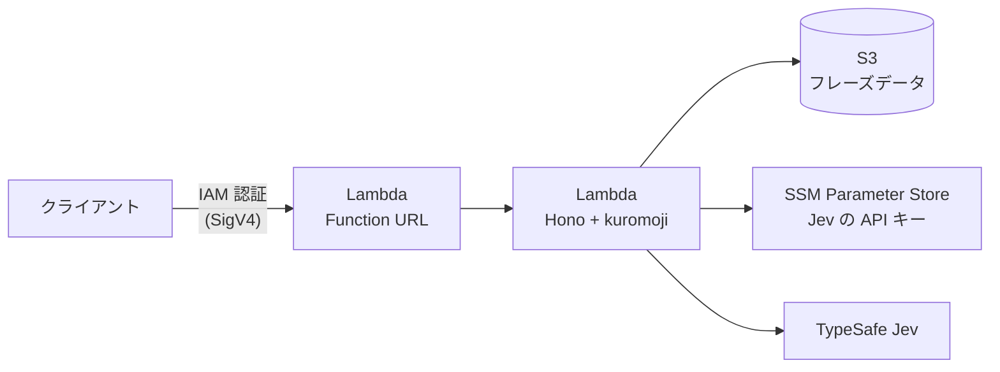

# niteru-lab

[](https://github.com/iwafuchi/niteru-lab/actions/workflows/ci.yml)

歌詞などのフレーズと入力文が「似てる」かを判定する、学習用のアプリケーションです。

**主な目的は AWS CDK と GitHub Actions の学習**です。アプリ自体は小さく保ち、インフラのコード化・CI/CD・テストの整備に重点を置いています。想定するリクエストは少量です。

> [!NOTE]
> 個人の学習用リポジトリのため、Issue と Pull Request は受け付けていません。

## 仕組み

> [!NOTE]
> 以下の仕組みと構成は完成形を示しています。一部は実装中です。

入力文とフレーズを**読み（カナ）**にそろえてから比較します。表記ゆれ（漢字・かな・全角半角・空白）に左右されずに判定するためです。

1. **正規化**：NFKC 正規化のあと、空白と記号を取り除く（「あ い」と「あい」を同一視する）
2. **読みに変換**：kuromoji で形態素解析し、読み（カタカナ）を得る
3. **候補の絞り込み**：読みの文字 n-gram の Jaccard 係数で、似ているフレーズを上位だけ選ぶ。2 文字程度の短い入力は n-gram が不安定なため、1-gram も併用する
4. **最終判定**：上位の候補だけを外部 API（TypeSafe Jev）で判定し、類似度（0〜1）と関係（同一 / 言い換え / 無関係）を返す

計算の軽い n-gram で候補を絞ってから外部 API を呼ぶことで、API の呼び出し回数を抑えます。

## 構成



| 要素       | 使用技術                                                           |
| ---------- | ------------------------------------------------------------------ |
| API        | TypeScript、[Hono](https://hono.dev/)（`hono/aws-lambda`）         |
| 形態素解析 | [kuromoji.js](https://github.com/takuyaa/kuromoji.js)              |
| 実行環境   | AWS Lambda（Node.js 24）+ Function URL（IAM 認証のみ、非公開）     |
| データ     | S3（フレーズデータ）、SSM Parameter Store SecureString（API キー） |
| インフラ   | AWS CDK。Dev / Prod を同じ Stack の `stage` で切り替える           |
| CI/CD      | GitHub Actions。AWS への認証は OIDC                                |

費用と構成を小さく保つため、NAT Gateway・VPC エンドポイント・Secrets Manager は使いません。Lambda の同時実行数も制限します。

## 必要なもの

- [mise](https://mise.jdx.dev/)：Node.js・pnpm・gitleaks のバージョンを `mise.toml` で固定しています
- Docker：AWS のローカルエミュレーター（[Floci](https://floci.io/)）を動かすときに使います

## セットアップ

```bash
git clone https://github.com/iwafuchi/niteru-lab.git
cd niteru-lab
mise install
pnpm install
```

`pnpm install` の実行時に git hooks（lefthook）も設定されます。

## 使い方

ローカルで API を起動します。ファイルを変更すると自動で再起動します。

```bash
pnpm dev
```

```bash
curl -X POST http://localhost:3000/tokenize \
  -H 'content-type: application/json' \
  -d '{"text":"夜に駆ける"}'
```

```json
{
  "text": "夜に駆ける",
  "reading": "ヨルニカケル",
  "tokens": [
    { "surface": "夜", "reading": "ヨル", "pos": "名詞" },
    { "surface": "に", "reading": "ニ", "pos": "助詞" },
    { "surface": "駆ける", "reading": "カケル", "pos": "動詞" }
  ]
}
```

### API

| メソッド | パス        | 内容                                            |
| -------- | ----------- | ----------------------------------------------- |
| `GET`    | `/health`   | 稼働確認。`{"status":"ok"}` を返す              |
| `POST`   | `/tokenize` | `text` を形態素解析し、読みと形態素の一覧を返す |

`POST /tokenize` の `text` は 1〜1000 文字で、空白や記号以外の文字か数字を 1 文字以上含む必要があります。文字数は見た目の 1 文字（書記素）単位で数えます。条件を満たさない場合は `400` と `{"error": "..."}` を返します。辞書にない語（英字など）は、表記をそのまま読みとして返します。

## 開発

| コマンド                                           | 内容                                                                                              |
| -------------------------------------------------- | ------------------------------------------------------------------------------------------------- |
| `pnpm dev`                                         | ローカルで API を起動（ポートは環境変数 `PORT`、既定は 3000）                                     |
| `pnpm check`                                       | 整形の確認・Lint・型チェック・テスト・`cdk synth` をまとめて実行（PR を作る前に通す）             |
| `pnpm test`                                        | unit と integration のテストを実行                                                                |
| `pnpm test:unit` / `test:integration` / `test:e2e` | 層ごとにテストを実行                                                                              |
| `pnpm test:watch`                                  | 変更を検知してテストを再実行                                                                      |
| `pnpm floci:up` / `floci:down`                     | ローカルの AWS エミュレーター（Floci）を起動 / 停止（Floci が起動した Lambda のコンテナも削除）   |
| `pnpm cdk:local <コマンド>`                        | CDK を Floci に向けて実行（例：`pnpm cdk:local deploy`）。認証情報は Floci 用のダミーに差し替える |
| `pnpm lint` / `lint:fix`                           | 型情報を使う Lint（oxlint）/ 自動修正                                                             |
| `pnpm format` / `format:check`                     | 整形（oxfmt）/ 整形済みかの確認                                                                   |
| `pnpm typecheck`                                   | 型チェック（TypeScript 7）                                                                        |

### ローカルの AWS エミュレーター

[Floci](https://github.com/floci-io/floci) で S3・SSM・Lambda などをローカルで動かせます（選んだ理由は [docs/decisions/0002](docs/decisions/0002-local-aws-emulator.md)）。

```bash
pnpm floci:up
pnpm cdk:local bootstrap aws://000000000000/ap-northeast-1   # 起動するたびに 1 回
pnpm cdk:local deploy
pnpm floci:down
```

`deploy` の出力に Function URL が表示されます（例：`http://xxxx.lambda-url.ap-northeast-1.localhost:4566/`）。

```bash
curl -X POST http://xxxx.lambda-url.ap-northeast-1.localhost:4566/tokenize \
  -H 'content-type: application/json' -d '{"text":"夜に駆ける"}'
```

AWS CLI で Floci を操作するときは、接続先と認証情報を Floci 用にします。

```bash
export AWS_ENDPOINT_URL=http://127.0.0.1:4566 AWS_ACCESS_KEY_ID=test AWS_SECRET_ACCESS_KEY=test AWS_DEFAULT_REGION=ap-northeast-1
aws lambda list-functions
```

Floci は状態をメモリに持つため、停止するとデプロイしたものも bootstrap も消えます。IAM の認証と権限は検証されないため、それらは本物の AWS で確認します。

### 品質を保つ仕組み

同じ検査をローカルと CI の両方で実行します。ローカルの git hooks は `--no-verify` で飛ばせるため、CI が最終的なガードです。

| タイミング     | 検査                                                                                                       |
| -------------- | ---------------------------------------------------------------------------------------------------------- |
| コミット時     | 秘密情報（gitleaks）、整形、Lint、コミットメッセージ（commitlint）                                         |
| push 時        | 型チェック、テスト                                                                                         |
| PR を作る前    | `pnpm check`（上記に加えて `cdk synth`）と、観点表によるセルフレビュー（[docs/review.md](docs/review.md)） |
| CI（PR・main） | `pnpm check` と同じ検査、秘密情報、コミットメッセージ。`main` へのマージには CI の成功が必須               |

### ディレクトリ構成

```
src/
├─ app.ts         ルーティング（実行環境に依存しない）
├─ local.ts       ローカル開発用のエントリポイント
├─ lambda.ts      Lambda 用のエントリポイント
├─ normalize.ts   正規化（NFKC・小文字化・空白と記号の除去）
├─ tokenizer.ts   kuromoji による形態素解析
├─ reading.ts     比較用の読み（カタカナ）への変換と、2 つの文の比較
├─ similarity.ts  読みの n-gram による類似度（Jaccard 係数）
└─ validation.ts  入力検証（zod）
infra/
├─ bin/app.ts     CDK アプリ（デプロイ先を選ぶ）
└─ lib/           スタックの定義（Lambda と Function URL）
scripts/          Floci の停止、CDK を Floci に向ける実行スクリプト
test/
├─ unit/          純粋な関数のテスト
├─ integration/   辞書や HTTP 層を組み合わせたテスト
└─ e2e/           デプロイ済み環境へのテスト
docs/             規約と設計の判断の記録
```

### ルール

規約と設計の判断の記録は [docs/](docs/README.md) にまとめています。

- コミットメッセージ：[docs/commit.md](docs/commit.md)（Conventional Commits。本文に変更の理由と判断を書く）
- ブランチと PR：[docs/pull-request.md](docs/pull-request.md)
- セルフレビュー：[docs/review.md](docs/review.md)
- テスト：[docs/testing.md](docs/testing.md)（テストピラミッド。テストを仕様のガードとして書く）
- 依存関係：[docs/dependencies.md](docs/dependencies.md)（Dependabot、チェックサムによる固定）
- 設計の判断：[docs/decisions/](docs/decisions/README.md)
